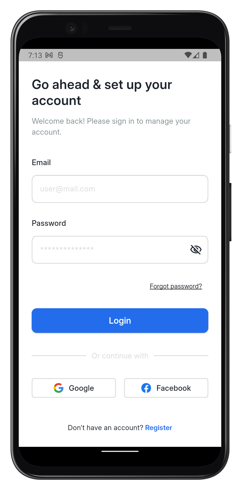
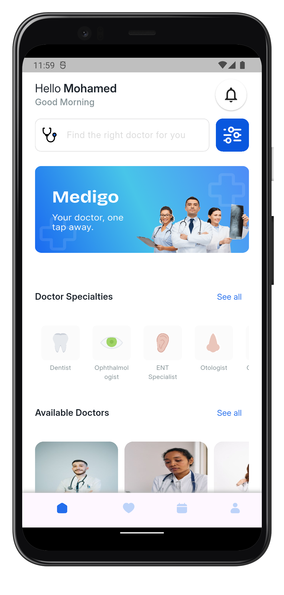
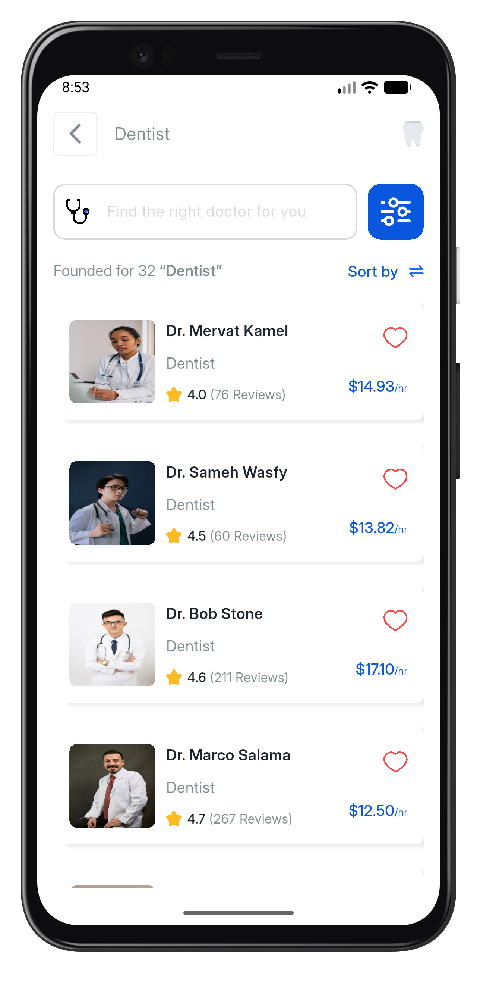
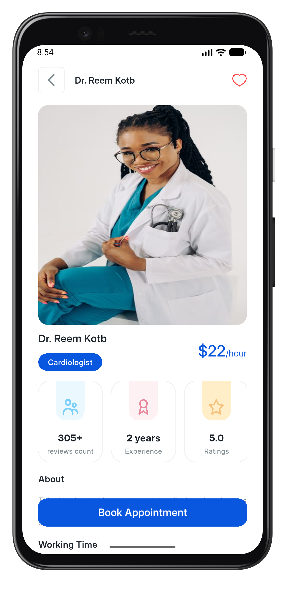
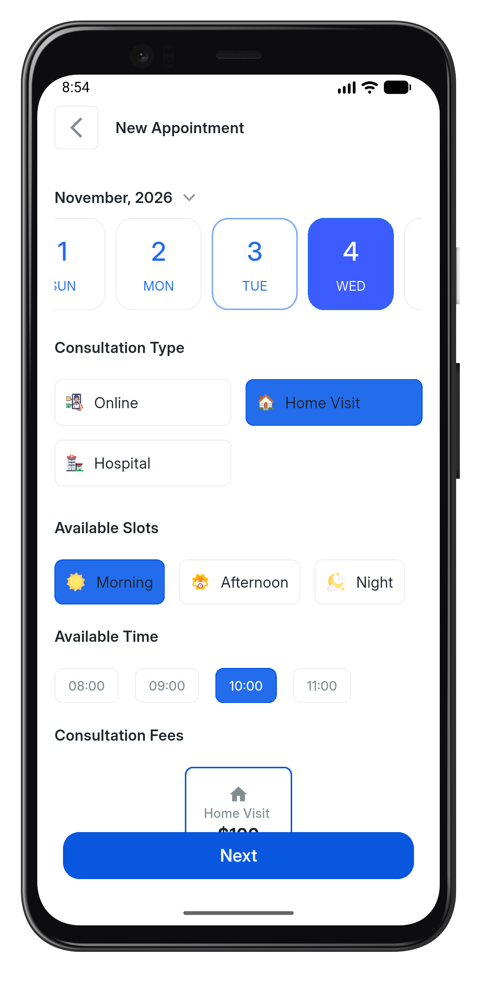
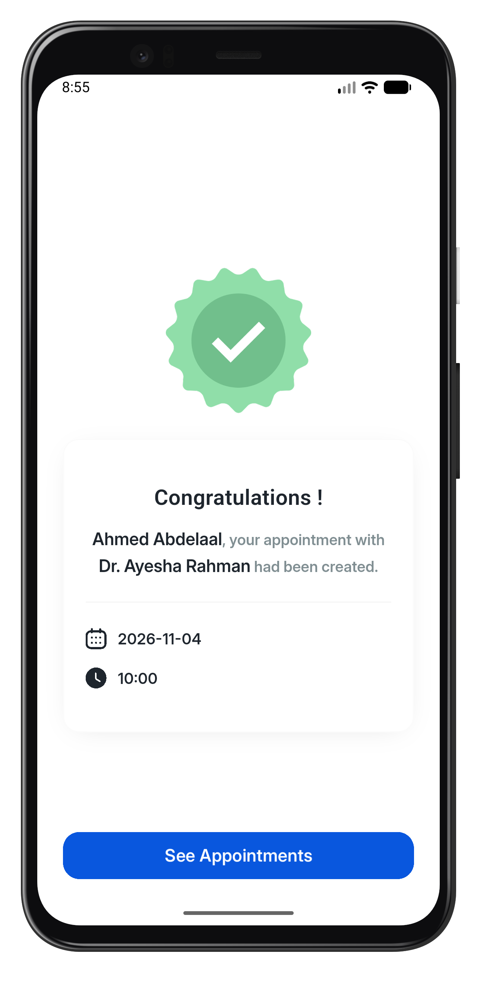
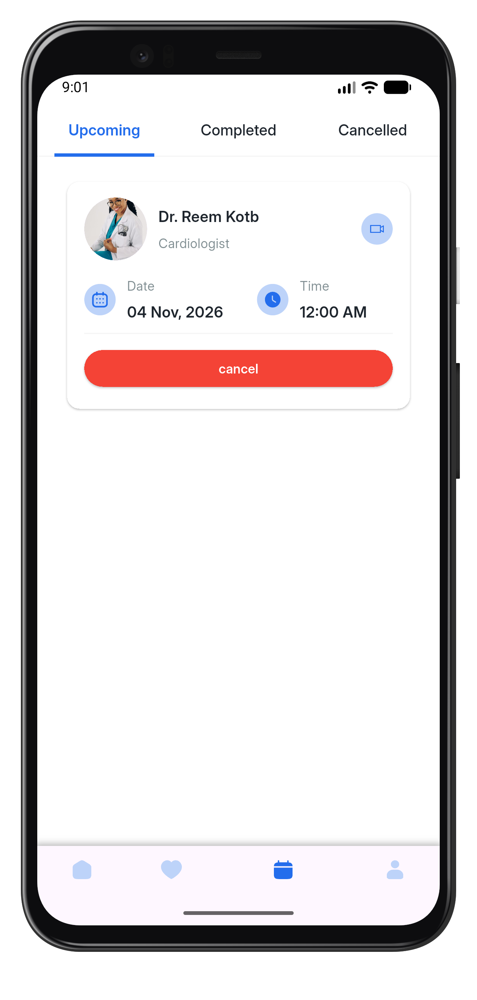
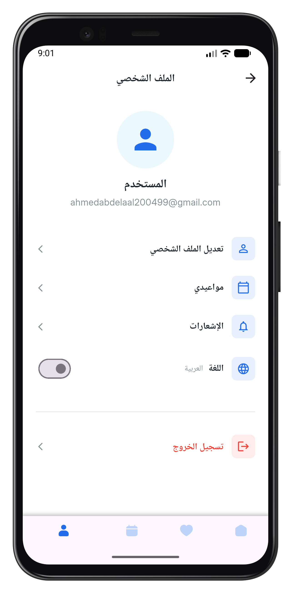

<p align="center">
  
</p>

# Medigo

**Medigo** is a Flutter mobile app for finding doctors and booking appointments: browse specialties, check a doctor's profile and available slots, then book in a few taps. The backend runs on [Supabase](https://supabase.com), and the app supports **English and Arabic**.

## Features

- Onboarding, splash screen, and email/password **sign up & login** (Supabase Auth)
- **Home**: specialties, popular doctors, and available doctors
- **Doctor details** with consultation types, fees, and working hours
- **Book an appointment**: pick a slot, enter patient details, get a confirmation screen
- **My appointments**: upcoming, completed, and cancelled tabs
- **Search** and **favourites** for doctors
- **Profile** screen
- Localization: English / Arabic (`lib/l10n`)

## Screenshots

<p align="center">
  
  
  
  
</p>

<p align="center">
  
  
  
  
</p>

## Tech stack

| Area | Packages |
| --- | --- |
| State management | `flutter_bloc`, `bloc`, `freezed` |
| Backend | `supabase_flutter` |
| Dependency injection | `get_it` |
| UI | `flutter_screenutil`, `flutter_svg`, `google_fonts`, `skeletonizer`, `flutter_spinkit` |
| Models / JSON | `json_serializable`, `json_annotation`, `dartz` |
| Localization | `flutter_localizations`, `intl` |

## Project structure

```
lib/
├── core/        # routing, DI, networking, theming, shared widgets
├── data/        # shared models and dummy data
├── features/    # auth, onboarding, home, appointment, search, liked, profile
├── l10n/        # en / ar translations
└── main.dart
```

Each feature follows `data/ → logic/ (Cubit) → ui/`.

## Getting started

```bash
git clone <this-repo-url>
cd medigo
flutter pub get
dart run build_runner build --delete-conflicting-outputs
flutter gen-l10n
flutter run
```

Requires Flutter with Dart SDK `^3.12.2`.

### Supabase configuration

The Supabase URL and publishable key are set in `lib/main.dart`. To use your own project, replace them with the values from **Project Settings → API**:

```dart
await Supabase.initialize(
  url: 'https://<your-project>.supabase.co',
  publishableKey: '<your-publishable-key>',
);
```

To skip email verification during development, turn off **Confirm email** under **Authentication → Sign In / Providers → Email**.
